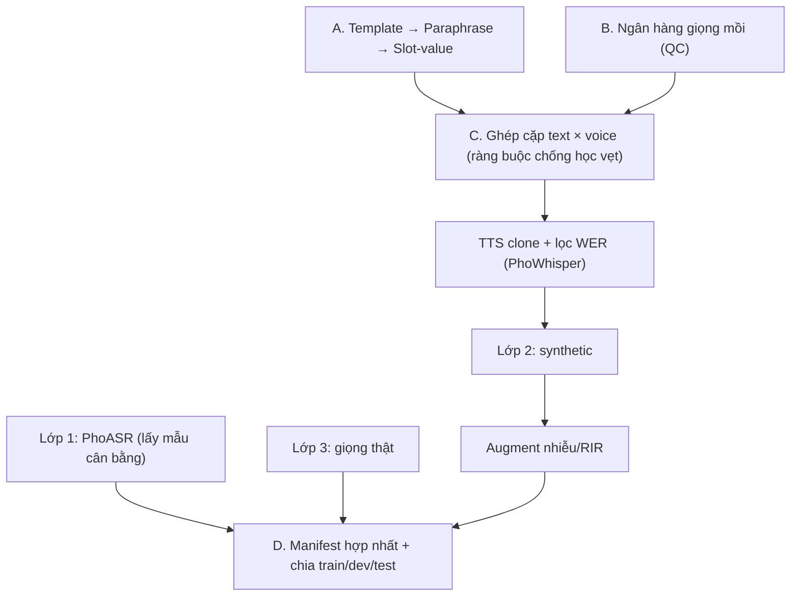

# Quy trình xây dựng bộ dữ liệu ASR lệnh giọng nói trên xe (tiếng Việt)

> Tài liệu triển khai hợp nhất: chuẩn văn bản (A), chuẩn giọng mồi & clone (B), ghép nối & chia tập (C), manifest (D). Mục tiêu chung: **mô hình học nghe nội dung, không học thuộc lối tắt**.

## 1. Kiến trúc tổng thể



## 2. Các lối tắt cần chặn

| Lối tắt mô hình có thể học | Biện pháp |
| --- | --- |
| "Giọng X ⇒ câu Y" | Ghép giọng ngẫu nhiên có ràng buộc; mỗi (template, voice) không lặp (§5) |
| Một giọng áp đảo | Mỗi giọng ≤ \~3% tổng file |
| Vị trí slot cố định ("22 độ" luôn cuối câu) | `slot_position: variable` |
| Nhớ số cụ thể (22, 24, 26) | Phân phối slot rải rộng, mỗi giá trị ≤ 3–5% |
| Học "công thức câu" | Giới hạn n-gram lặp; loại biến thể giả đa dạng |
| Rò rỉ train → test | Chia theo template; giọng, nhiễu/RIR của test tách riêng |

## 3. Lớp 1 – Dữ liệu PhoASR (lấy mẫu cân bằng)

- Lấy tập con từ PhoASR, cân bằng theo vùng miền, giới tính, và **giới hạn số phút/người** để tránh lệch người nói.
- Chuyển về đúng schema manifest (§10), `layer = L1_phoasr`; các trường intent/target_json để trống nếu không áp dụng.
- *Cần chốt:* số giờ lấy mẫu, mức trần phút/người.

## 4. Lớp 2 – Chuẩn sinh văn bản (A)

### 4.1 Template gốc

- **≥ 150–200 template**, phủ toàn bộ bảng Intent × Slot.
- Slot được **ngẫu nhiên hóa khi sinh**, không dùng một giá trị mẫu cố định.

```json
{
  "template_id": "HVAC_SET_TEMP_01",
  "intent": "CMD_EDGE",
  "slot_schema": {"temp": "int[16-30]"},
  "slot_position": "variable",
  "style_pool": ["formal","casual","blunt","question_form","self_correct"],
  "region_lexicon_variants": {"Bac":"điều hòa","Nam":"máy lạnh","Trung":"điều hòa"},
  "json_target": {"action":"set_hvac","temp":"{temp}"}
}
```

### 4.2 Paraphrase bằng LLM

- Mỗi template sinh **5–8 biến thể**, trải đều 5 trục: lịch sự, dạng câu, độ dài, khẩu ngữ, từ vựng vùng miền.
- Slot được đặt ở nhiều vị trí khác nhau ("chỉnh 22 độ" / "22 độ nhé" / "để tôi 22 độ thôi").

| Kiểm soát | Cách làm |
| --- | --- |
| Giới hạn n-gram | Quét cụm 3–4 từ trên toàn bộ; cụm nào > 2% tổng câu thì loại bớt biến thể dư |
| Độ tương đồng | Embedding (ví dụ PhoBERT); loại cặp cùng template có cosine > 0,92 |

### 4.3 Slot-value

- Nhiệt độ: rải đều 16–30. Phần trăm: lẫn mốc tròn, mốc khẩu ngữ (nửa, phần tư) và số lẻ (37%, 63%).
- Mỗi giá trị ≤ \~3–5% trong template; script đếm tần suất sau khi sinh.

### 4.4 Hai dạng văn bản

- `text_spoken`: dạng đọc ("hai mươi hai độ") → đưa vào TTS và để so WER.
- `text_gt`: dạng viết chuẩn ("22 độ") → nhãn huấn luyện.

## 5. Lớp 2 – Ngân hàng giọng mồi & clone (B)

### 5.1 Tiêu chuẩn giọng mồi

| Tiêu chí | Ngưỡng |
| --- | --- |
| Nguồn | VIVOS, CMV-vi-14 (đã kiểm chứng sạch >85% theo PhoASR) |
| Độ dài file mồi | 6–10 giây |
| SNR | > 25 dB, **đo bằng công cụ** (ví dụ pysepm), không chỉ nghe tai |
| Số giọng | 40–60, chia đều Bắc/Trung/Nam, cân bằng nam/nữ |
| Giới hạn dùng | Mỗi giọng ≤ \~3% tổng file sinh |
| `ref_text` | Khớp chính xác với audio mồi |

### 5.2 Ghép cặp chống học vẹt

1. **1 giọng ngẫu nhiên cho mỗi câu** (không dùng 3 giọng cố định/câu).
2. Không để cùng một `(template_id, voice_id)` xuất hiện quá 1 lần.
3. Theo dõi **ma trận phủ** template-nhóm × vùng miền giọng, để mỗi nhóm (CMD, QA, BOUNDARY…) có đủ cả 3 miền.

```text
for câu in danh_sách_câu (đã xáo trộn):
    ứng_viên = [v for v in giọng_cùng_split_với(câu.template_id)
                if (câu.template_id, v) chưa dùng and số_file[v] < trần_3%]
    v = chọn theo ma trận phủ (ưu tiên vùng miền còn thiếu)
    audio = TTS(ref_audio[v], ref_text[v], câu.text_spoken)
    ghi: audio_file, template_id, voice_id, voice_region, text_gt, intent, target_json
```

### 5.3 TTS và lọc chất lượng

- Mô hình: **viXTTS** (cộng đồng tinh chỉnh từ XTTS-v2 trên viVoice) hoặc **F5-TTS tiếng Việt**. XTTS-v2 gốc không chính thức hỗ trợ tiếng Việt, nên cần kiểm tra phiên bản và giấy phép trước khi dùng.
- Lọc: chạy PhoWhisper-large trên audio, so với **`text_spoken`** (không phải `text_gt`); giữ **WER \< 5%**; sinh lại tối đa 3 lần (đổi seed), vẫn trượt thì loại và ghi log.
- Tốc độ ước tính \~0,5–1,5 giây/file trên T4 → 5.000 file ≈ 40–125 phút, không phải nút thắt.

## 6. Lớp 3 – Giọng thật

| `source` | Mô tả | Dùng cho |
| --- | --- | --- |
| `friend_phone` | 15–20 bạn bè 3 miền, ghi âm qua Zalo/điện thoại, **đọc đúng kịch bản sinh từ template** (gồm biến thể khẩu ngữ) | Một phần người vào train, phần người còn lại là Golden Test |
| `in_car` | Thu thật trong xe (nếu mượn được) | Lát test riêng, báo cáo tách biệt |
| `video_clip` | Đoạn 1 người nói rõ cắt từ video nhiều người nói; chép nhãn tay, không có intent/`target_json` | Stress test (hoặc train phụ), **không** vào Golden Test |

Quy tắc:

- **Chia theo người nói, không chia ngẫu nhiên theo câu:** \~12 người train / 3–4 người Golden Test, mỗi nhóm đủ 3 miền. Template của Golden Test không trùng template train (cả Lớp 2 và Lớp 3).
- Golden Test **hoàn toàn ngoài train** và không dùng để chọn checkpoint. Phần dữ liệu thật trong train lấy từ người nói và nguồn khác.
- Giọng bạn bè **không** dùng làm giọng mồi TTS (tránh rò rỉ Lớp 2 ↔ Lớp 3).
- Mỗi người đọc vài chục đến \~100 câu; ghi thiết bị, kênh, codec (Zalo nén mạnh); xin đồng ý sử dụng giọng.
- Video: Whisper có thể đã thấy nội dung đăng trước khi nó ra mắt, nên ưu tiên video đăng sau mốc đó hoặc ghi rõ rủi ro khi dùng baseline Whisper.

## 7. Augment, chia tập & trộn lớp (C)

| Hạng mục | Quy tắc |
| --- | --- |
| Chia tập | 80/10/10 **theo `template_id`**, phân tầng theo intent để tập nào cũng có đủ intent |
| Giọng | `voice_id` của dev/test **không xuất hiện trong train** |
| Nhiễu/RIR | Train: ngẫu nhiên on-the-fly. Dev/test: **cố định** (mỗi bản ghi lưu `snr_db`, `rir_id`) |
| Trộn lớp | Cấu hình chính: một lần fine-tune trên Lớp 2 + phần train Lớp 3 + replay Lớp 1 (\~10–20%, cần chốt). Thí nghiệm so sánh: 2 giai đoạn (A: Lớp 1 → B: Lớp 2 + 3) |

## 8. Huấn luyện

- Mô hình: whisper-small, language tag `vi`. Siêu tham số phải tự dò; bài tham chiếu (Timmel et al., arXiv 2412.15726) dùng Large-v2 nên không sao chép thẳng.
- **Cấu hình chính:** một lần fine-tune trên hỗn hợp Lớp 2 + phần train Lớp 3 + replay Lớp 1 để chống quên. Bài tham chiếu cũng fine-tune một lần trên hỗn hợp, trộn 125 giờ Common Voice tiếng Đức; WER trên CV13 de không tụt (6,42 so với 6,53 của mô hình gốc).
- **Thí nghiệm so sánh:** 2 giai đoạn (A: Lớp 1; B: Lớp 2 + 3). Đây là thiết kế riêng của dự án, không phải của bài báo.
- Augment: nhiễu/RIR on-the-fly, SpecAugment.
- **Tập dev riêng** để chọn checkpoint: synthetic dev (template, giọng riêng) và, nếu đủ người, 1–2 người thật tách thêm khỏi train và Golden Test. Golden Test không được dùng cho việc này.

## 9. Đánh giá

Chuẩn hóa trước khi tính: chữ thường, bỏ dấu câu, và một quy tắc số ↔ chữ tiếng Việt thống nhất cho `text_spoken`/`text_gt`.

| Tầng test | Vai trò | Cách báo cáo |
| --- | --- | --- |
| Test tổng hợp (template + giọng riêng, nhiễu/RIR cố định) | Sanity check | Không dùng làm kết quả chính |
| **Golden Test** (`friend_phone`, người nói riêng) | Kết quả chính | Kèm khoảng tin cậy bootstrap theo người nói và WER từng người |
| `in_car` (nếu có) | Domain đích thật | Báo cáo riêng |
| `video_clip` | Stress test | Chỉ WER (không có intent/slot) |

- **Chỉ số:** WER; độ chính xác intent; khớp chính xác slot trên `target_json` (đặc biệt số); tách theo miền, giới tính, mức SNR.
- **Baseline và ablation (cùng test):** whisper-small zero-shot; sau giai đoạn A; hỗn hợp không Lớp 3; hỗn hợp có Lớp 3; một lần so với hai giai đoạn.
- **Diễn giải:** chỉ kết luận "overfit vào tổng hợp" khi mô hình fine-tune không hơn baseline zero-shot **trên cùng Golden Test**. Không so thẳng WER giữa hai test khác nhau vì độ khó khác nhau (trong bài tham chiếu, Large-v2 gốc cũng tụt từ 64,15 xuống 48,89 BLEU giữa hai test). Bài cũng cảnh báo mô hình tốt trong phân phối vẫn có thể kém bản gốc ngoài phân phối.

## 10. Manifest hợp nhất (D)

Mọi lớp dùng chung một schema, chỉ khác `layer` và `source` (`phoasr` / `tts` / `friend_phone` / `in_car` / `video_clip`):

```json
{
  "id": "car_0001234",
  "audio_filepath": "wavs/L2_synthetic/car_0001234.wav",
  "duration": 3.45,
  "layer": "L2_synthetic",
  "source": "tts",
  "template_id": "HVAC_SET_TEMP_01",
  "text_spoken": "chỉnh điều hòa xuống hai mươi hai độ",
  "text_gt": "Chỉnh điều hòa xuống 22 độ.",
  "intent": "CMD_EDGE",
  "target_json": {"action": "set_hvac", "temp": 22},
  "voice_id": "v034", "voice_region": "Trung",
  "snr_db": 10, "rir_id": "cabin_rir_02",
  "split": "train"
}
```

## 11. Quy mô gợi ý (kiểm tra số học)

- Mục tiêu Lớp 2: \~5.000 file. 200 template ⇒ \~25 file/template ⇒ cần \~25 giọng khác nhau cho mỗi template (do ràng buộc template-voice không lặp). Muốn vậy, mỗi template phải có \~25 câu cụ thể = 5–8 paraphrase × nhiều giá trị slot.
- Trần 3%/giọng ⇒ ≤ 150 file/giọng.
- Gợi ý chia giọng: \~50 giọng = 42 train + 8 dev/test.

## 12. Điểm cần chốt trước khi chạy

1. **Xung đột dev/test:** dev/test dùng giọng riêng và template riêng, nên ràng buộc "mỗi (template, voice) một lần" giới hạn cứng số file. Ví dụ 20 template × 4 giọng chỉ cho 80 file. Đề xuất: chỉ áp ràng buộc nghiêm ngặt cho train; dev/test nới thành ≤ 3 lần/cặp với câu khác nhau, hoặc tăng số giọng/template của test.
2. **Ngưỡng n-gram 2%:** cụm từ khóa lõi ("điều hòa", "chỉnh … xuống") sẽ tự nhiên vượt ngưỡng. Nên loại cụm slot/từ khóa khỏi phép đếm hoặc nâng ngưỡng cho chúng.
3. Tỉ lệ trộn (replay L1 \~10–20%, L2, L3-train); số giờ L1; số câu mỗi người ở L3; kích thước dev.
4. Bảng Intent × Slot và 5 trục paraphrase cụ thể (chốt lần trước, cần đưa vào repo làm file cấu hình).
5. Giấy phép TTS, VIVOS, CMV-vi và đồng ý của người cho giọng.

## 13. Thứ tự triển khai

**Pha 1: Triển khai nguyên mẫu Mini-batch (Bắt buộc để gỡ lỗi toàn hệ thống)**
*Mục tiêu: Đảm bảo toàn bộ luồng pipeline từ khâu sinh JSON đến huấn luyện LoRA không bị văng lỗi (crash) trước khi tiêu tốn tài nguyên sinh hàng nghìn file.*
1. Chốt bảng Intent × Slot cốt lõi, viết khoảng 10–20 template nháp (JSON).
2. Tải và cắt 5–10 giọng mồi chuẩn từ VIVOS/CMV-vi-14 (đo SNR > 25 dB bằng pysepm).
3. Chạy script ghép cặp chống học vẹt để sinh ra khoảng 100 - 200 file. Kiểm tra phân phối ma trận.
4. Chạy TTS + lọc WER qua PhoWhisper cho 200 file này. 
5. Gộp Manifest mini (trộn thử Lớp 1, 200 file Lớp 2 và 50 file giọng thật Lớp 3). Ép RIR/Nhiễu on-the-fly và chạy thử script huấn luyện LoRA (1-2 epochs). Nếu hàm Loss giảm đều, chốt pipeline.

**Pha 2: Mở rộng quy mô (Scale-up) & Chạy toàn bộ**
6. Mở rộng lên đủ 150–200 template. Chạy script sinh paraphrase và kiểm soát n-gram/embedding chặt chẽ.
7. Chạy sinh toàn bộ ~5.000 file Lớp 2 qua TTS, kích hoạt bộ lọc WER < 5% và sinh lại tự động nếu trượt.
8. Lấy mẫu cân bằng hoàn chỉnh cho Lớp 1 và thu thập đủ số lượng Lớp 3 (giọng bạn bè, cắt video).
9. Gộp Manifest tổng hợp, chia split (Train/Dev/Test) theo đúng quy tắc.
10. Huấn luyện chính thức (Cấu hình một lần trộn hỗn hợp + Thí nghiệm 2 giai đoạn A/B) và Đánh giá theo cấu trúc 3 tầng (Mục 9).

**Checklist cuối trước khi train thực tế:** 
≥150 template · không n-gram >2% · không lặp cặp (template, voice) ở train · mỗi voice_id ≤ ~3% · SNR giọng mồi >25 dB · Test không chia sẻ template, người nói, RIR với Train · Golden Test tuyệt đối không dùng để chọn checkpoint.